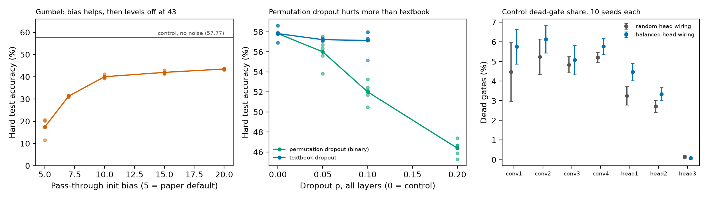

# Addendum 3: permutation dropout, Gumbel bias 15 and 20, scale M skips, per-gate shares (2026-11-12)

Hard = pure binary test accuracy; gap = soft minus hard (points). Scale S, crop/flip, 200 epochs. Welch tests against the matched control (base seeds 0-4, mean 57.83; base seeds 0-2 for the bias arms, mean 57.77). Not corrected for multiple comparisons.

## 1. Permutation dropout (Liping's binary-preserving scheme), dropout on all layer inputs, 5 seeds each

Within each example, the dropped positions keep their values but are randomly permuted, so outputs stay 0 or 1 and the number of ones per example is unchanged. Option `--dropout-mode perm`; 13 new tests (401 pass).

| Arm | Hard | Difference | p (hard) | Gap | p (gap) |
|---|---|---|---|---|---|
| Control | 57.83 | | | 3.46 | |
| Permutation p = 0.05 | 56.01 +- 1.40 | -1.82 | 0.041 | 2.57 | 0.040 |
| Permutation p = 0.1 | 52.01 +- 1.03 | -5.82 | <0.001 | 2.65 | 0.021 |
| Permutation p = 0.2 | 46.39 +- 0.81 | -11.44 | <0.001 | 1.51 | 0.001 |
| Textbook p = 0.05 (same layers) | 57.22 +- 0.13 | -0.61 | 0.087 | 4.39 | 0.015 |
| Textbook p = 0.1 (same layers) | 57.14 +- 1.16 | -0.69 | 0.29 | 0.92 | 0.007 |

Permutation dropout lowers hard accuracy at every p, and it falls steadily as p grows. The gap shrinks only because soft accuracy falls faster than hard (at p = 0.2 soft drops about 13 points and hard about 11). The textbook version at the same p is much closer to the control. So the binary-preserving version costs accuracy here.

## 2. Gumbel with a larger pass-through bias (3 seeds each)

| Bias | Hard | Difference from control (57.77) |
|---|---|---|
| 5 (paper default) | 17.39 +- 5.16 | -40.4 |
| 7 | 31.28 +- 0.39 | -26.5 |
| 10 | 40.03 +- 1.00 | -17.7 |
| 15 | 41.98 +- 0.91 | -15.8 |
| 20 | 43.50 +- 0.37 | -14.3 |

The gain levels off at about 43: going from 10 to 20 adds 3.5 points. A larger bias alone does not close the gap to the control (all p < 0.001).

## 3. Scale M, crop/flip, 200 epochs (2 seeds each)

| Arm | Seeds | Hard | Soft | Gap |
|---|---|---|---|---|
| Baseline | 0 (70.53 run), 1 (rerun 69.85) | 70.19 | | |
| Both skip connections | 0, 1 | 70.72 (70.80, 70.64) | 72.54 | 1.82 |

Both skips are +0.53 over the baseline (Welch p = 0.35, n = 2 each), which is not resolved. The same seed-1 baseline was run twice and gave 69.68 and 69.85, so repeat noise at this scale is about 0.2 points. The paper's number for M is 71.01. Seed 0 of both skips (70.80) is the closest result so far to the paper.

## 4. Dead gates over 10 seeds each (control, hard network, share below 1% or above 99%)

| Layer | Random head wiring | Balanced head wiring |
|---|---|---|
| conv1 | 4.5 | 5.8 |
| conv2 | 5.2 | 6.1 |
| conv3 | 4.8 | 5.1 |
| conv4 | 5.2 | 5.8 |
| head1 | 3.3 | 4.5 |
| head2 | 2.7 | 3.3 |
| head3 | 0.1 | 0.1 |
| all gates | 3.0 (range 2.6 to 3.5) | 3.8 |

Seed 0 of the random-wiring control reproduces the earlier single-seed analysis (2.8% overall). In the control, only about 3% of gates are dead in any seed, so there is little to correct by that measure. Balanced wiring raises the dead share slightly (+0.8 points overall).

*Figure A3. Left: Gumbel hard accuracy against the pass-through bias (dots = seeds). Middle: permutation dropout against textbook dropout, all layers (dots = seeds). Right: dead-gate share by layer, mean and SD over 10 seeds.*
