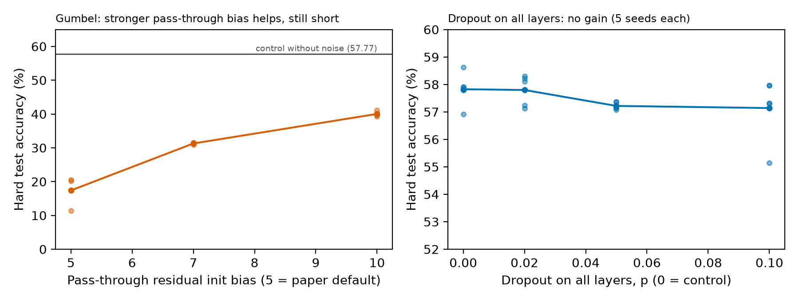

# Addendum: pass-through bias and dropout on all layers (scale S, crop/flip, 200 epochs)

Status 2026-11-10. All 24 runs finished. Hard = pure binary test accuracy. Welch tests are against the matched control (base seeds 0-4 for dropout; base seeds 0-2 for the bias arms). p-values are not corrected for multiple comparisons.

| Arm | Seeds | Hard (mean +- SD) | Control | Difference | p |
|---|---|---|---|---|---|
| Dropout p = 0.02, all layers | 5 | 57.80 +- 0.57 | 57.83 | -0.03 | 0.94 |
| Dropout p = 0.05, all layers | 5 | 57.22 +- 0.13 | 57.83 | -0.61 | 0.09 |
| Dropout p = 0.1, all layers | 5 | 57.14 +- 1.16 | 57.83 | -0.69 | 0.29 |
| Pass-through bias 10, no Gumbel | 3 | 57.87 +- 0.44 | 57.77 | +0.10 | 0.87 |
| Gumbel, bias 5 (paper default) | 3 | 17.39 +- 5.16 | 57.77 | -40.4 | < 0.01 |
| Gumbel, bias 7 | 3 | 31.28 +- 0.39 | 57.77 | -26.5 | < 0.01 |
| Gumbel, bias 10 | 3 | 40.03 +- 1.00 | 57.77 | -17.7 | < 0.01 |

What this shows:
1. Dropout on all layers gives no gain at any p. p = 0.1 lowers hard accuracy slightly, not significantly.
2. A larger pass-through bias does not hurt by itself (bias 10 without Gumbel matches the control).
3. Gumbel accuracy rises steadily with the bias (17.4, 31.3, 40.0). The bias is part of the failure, but even bias 10 stays 17.7 points below the control. The init alone does not explain it.

*Figure A1. Left: Gumbel hard accuracy against the pass-through bias of the residual init (dots = seeds 0-2, line = mean). Right: dropout on all layers, p = 0 is the 10-seed control mean for the matching base runs (dots = seeds 0-4).*

## Head-only dropout p = 0.05: confirmation runs (scale S, crop/flip, 200 epochs)

The seeds 0-4 result (58.78 against 57.83, p = 0.064) was the basis for choosing this arm, so seeds 5-9 are the fresh test.

| Arm | Seeds | Hard (mean +- SD) | Compared with | Difference | p |
|---|---|---|---|---|---|
| Head dropout p = 0.05, all 10 seeds | 10 | 58.54 +- 0.61 | control, 10 seeds (57.69 +- 0.85) | +0.84 | 0.022 |
| Head dropout p = 0.05, seeds 5-9 only (fresh) | 5 | 58.29 +- 0.28 | control seeds 0-4 (57.83) | +0.47 | 0.17 |
| Head dropout p = 0.05 + balanced wiring | 5 | 59.10 +- 1.01 | balanced wiring alone (58.99) | +0.11 | 0.87 |
| Head dropout p = 0.05 + balanced wiring | 5 | 59.10 +- 1.01 | control seeds 0-4 (57.83) | +1.27 | 0.049 |

Reading: the 10-seed gain (+0.84, p = 0.022) is partly driven by the seeds picked for the first look. On fresh seeds the gain is +0.47 and not significant. Dropout adds nothing on top of balanced wiring. Soft/hard gap is unchanged (3.61 against 3.55). These p-values are uncorrected.
