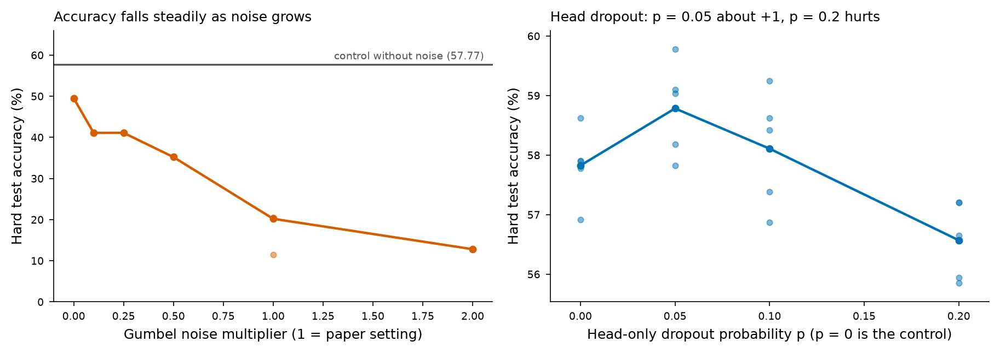
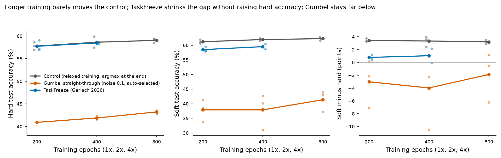

# Gumbel noise, progressive freezing, training length and dropout on LogicTreeNet (CIFAR-10)

Isaac Gong, Liu lab (Tufts). Results as of 2026-11-03. Every number comes from a logged run (files listed at the end). Hard = pure binary network (argmax gates), soft = relaxed network (plain softmax), gap = soft minus hard, in percentage points.

## 1. Summary

1. **Gumbel straight-through sampling (Yousefi et al., arXiv:2506.07500) does not train on LogicTreeNet-S with the LogicTreeNet recipe.** At the paper's setting (noise 1, tau 1) hard accuracy is 17.39 (SD 5.16, 3 seeds) against 57.77 for the control. Accuracy falls steadily as the noise grows (Figure 1, left). With noise 0.1 and 4x training it reaches 43.22. The same failure appears in torchlogix 0.2.2 (23.55 and 27.16).
2. **Training longer is not the explanation.** The control gains +0.85 and +1.27 hard at 2x and 4x (p = 0.38 and 0.11) and its gap moves from 3.43 to 3.21 (p = 0.40), inside seed noise. Gumbel stays about 16 points below the control at every budget.
3. **TaskFreeze (Gerlach, arXiv:2609.33747) shrinks the gap without raising hard accuracy.** Gap 0.78 against 3.43 (p = 0.001) at 200 epochs, hard unchanged (57.72, p = 0.95). The gain over FinalArgmax reported in that paper is not reproduced at our budget.
4. **The best scale-S results come from balanced head wiring** (hard 58.99 over 5 seeds, +1.17, p = 0.049) and, marginally, head-only dropout with p = 0.05 (+0.96, p = 0.064). Nothing reaches the paper's 60.38. Combining these does not stack.
5. **Scale-M dropout is closed:** no placement or p beats the control (70.11, SD 0.60, n = 2) beyond noise.

## 2. What was implemented (all behind flags that are off by default; 388 tests pass)

| Flag | Source | Notes |
|---|---|---|
| `--gumbel`, `--gumbel-tau` (1), `--gumbel-scale` (1) | Yousefi et al. Sec. 4, Algorithm 1 (App. E), tau = 1 (App. H.1) | Forward: one-hot of argmax(logits + noise). Backward: softmax((logits + noise)/tau). Noise is drawn once per forward call with the shape of the logits, shared over batch and positions, as with `F.gumbel_softmax` in their code. The noise multiplier is our extension; the paper has no such knob. Evaluation is unchanged (soft = plain softmax, hard = argmax). |
| `--freeze global`, `--freeze task`, `--freeze-start-epoch`, `--freeze-k`, `--freeze-patience`, `--freeze-beta` | Gerlach Sec. 4.3, Algorithm 1, App. B | Start at 12.5% of training, K = 1000 steps, P = 3, beta = 2^(-K/10000). TaskFreeze scores each neuron by the first-order change in loss from committing its argmax gate (checked against the exact loss change in a unit test). |
| `--dropout-where convlate` | ours | Dropout only on the outputs of conv blocks 2 and 3. |

Deviations and ambiguities to keep in mind:

1. **Recipe.** The control uses the LogicTreeNet recipe (AdamW, lr 0.02, weight decay 0.002, Petersen et al. App. A.2). Yousefi et al. use Adam with lr 0.01 on dense networks. One run per noise setting used their optimizer (Section 3.1).
2. **Noise sharing.** Noise is shared over the batch and over all spatial positions of a conv tree. The paper's text says "stochastically selecting individual gates per forward pass"; which sharing they use for conv layers is not stated.
3. **GlobalFreeze.** Fixing every gate leaves nothing trainable in LogicTreeNet (fixed wiring), so the literal reading is only an argmax at epoch 25. We also ran a straight-through reading (discrete forward pass from epoch 25, gates keep learning, weight decay 0 in that phase, which differs from Gerlach's setup).
4. **Budget.** 1x = 200 epochs (about 70k steps). Gerlach trains TreeLogicNet-S for 200k steps, about 2.8x our 1x.
5. **Statistics.** Welch tests, not corrected for multiple comparisons; n is 2 to 5 per arm (3 for most scale-S arms), so small effects are not resolved.

## 3. Results

### 3.1 Gumbel, noise and temperature (scale S, crop/flip, seed 0 unless noted)

| Setting (seed 0, 200 epochs) | Hard | Soft | Gap |
|---|---|---|---|
| Noise 0 (argmax forward, softmax backward) | 49.50 | 48.93 | -0.57 |
| Noise 0.1 | 41.09 | 41.24 | 0.15 |
| Noise 0.25 | 41.10 | 41.05 | -0.05 |
| Noise 0.5 | 35.20 | 37.64 | 2.44 |
| Noise 2 | 12.80 | 10.00 | -2.80 |
| tau 0.25, noise 1 | 25.04 | 25.10 | 0.06 |
| tau 2, noise 1 | 23.66 | 24.51 | 0.85 |
| Adam lr 0.01, no weight decay, noise 1 | 23.04 | 25.27 | 2.23 |
| Adam lr 0.01, no weight decay, noise 0.5 | 40.66 | 41.66 | 1.00 |
| Noise 1, tau 1 (paper), seeds 0/1/2 | [20.2, 11.44, 20.53] | [23.66, 10.0, 21.42] | [3.46, -1.44, 0.89] |

*Figure 1. Left: hard accuracy against the noise multiplier (line: seed 0; the three dots at 1 are seeds 0 to 2). Right: head-only dropout, 5 seeds per p (dots), line = mean.*

Soft accuracy of Gumbel-trained networks swings between seeds (31.0 to 43.9 at 400 and 800 epochs with noise 0.1), so their gaps (-10.5 to +1.2) are not a reliable measure. The paper-style unused-gate share (entropy above the 2.5th percentile of N(0,1)-initialised neurons) is 83.8% for Gumbel with noise 0.1, against 45.8% for the control. The paper reports 0.00% for its dense networks, which we do not reproduce.

### 3.2 Training length and freezing (scale S, crop/flip)

*Figure 2. Hard accuracy, soft accuracy and gap against training epochs (1x, 2x, 4x = 200, 400, 800), dots = seeds, lines = means. Gumbel uses noise 0.1.*

| Arm | Epochs | n | Hard | Soft | Gap | Compared with | Diff. in hard | p (hard) | p (gap) |
|---|---|---|---|---|---|---|---|---|---|
| Control (relaxed training, argmax at the end) | 200 | 3 | 57.77 +- 0.85 | 61.20 +- 0.64 | 3.43 +- 0.27 |  |  |  |  |
| Control, longer training | 400 | 3 | 58.62 +- 1.22 | 61.96 +- 0.47 | 3.34 +- 0.78 | Control, 200 ep | 0.85 | 0.383 | 0.865 |
| Control, longer training | 800 | 3 | 59.04 +- 0.52 | 62.25 +- 0.61 | 3.21 +- 0.30 | Control, 200 ep | 1.27 | 0.106 | 0.402 |
| Control, longer training | 800 | 3 | 59.04 +- 0.52 | 62.25 +- 0.61 | 3.21 +- 0.30 | Control, 400 ep | 0.42 | 0.627 | 0.809 |
| Gumbel, paper setting (noise 1, tau 1) | 200 | 3 | 17.39 +- 5.16 | 18.36 +- 7.33 | 0.97 +- 2.45 | Control, 200 ep | -40.38 | 0.004 | 0.223 |
| Gumbel, noise 0.1 (picked on validation) | 200 | 3 | 40.92 +- 0.15 | 37.90 +- 3.78 | -3.02 +- 3.69 | Control, 200 ep | -16.85 | 0.001 | 0.093 |
| Gumbel, noise 0.1 | 400 | 3 | 41.88 +- 0.40 | 37.90 +- 6.10 | -3.98 +- 5.88 | Control, 400 ep | -16.74 | 0.001 | 0.162 |
| Gumbel, noise 0.1 | 800 | 3 | 43.22 +- 0.43 | 41.34 +- 3.64 | -1.88 +- 3.88 | Control, 800 ep | -15.82 | <0.001 | 0.151 |
| TaskFreeze | 200 | 3 | 57.72 +- 1.15 | 58.50 +- 0.84 | 0.78 +- 0.38 | Control, 200 ep | -0.05 | 0.952 | 0.001 |
| TaskFreeze | 400 | 3 | 58.41 +- 0.29 | 59.20 | 0.79 +- 1.18 | Control, 400 ep | -0.22 | 0.79 | 0.043 |
| GlobalFreeze, literal (all gates fixed at epoch 25) | 200 | 3 | 54.78 +- 0.47 | 56.07 +- 1.80 | 1.29 +- 2.23 | Control, 200 ep | -2.99 | 0.012 | 0.236 |
| GlobalFreeze, straight-through reading (ours) | 200 | 3 | 55.85 +- 0.36 | 52.72 +- 1.79 | -3.13 +- 2.08 | Control, 200 ep | -1.92 | 0.044 | 0.03 |
| GlobalFreeze, straight-through reading (ours) | 400 | 2 | 56.75 +- 0.90 | 54.19 +- 2.95 | -2.55 +- 2.05 | Control, 400 ep | -1.88 | 0.147 | 0.128 |
| Dropout p=0.05 on conv blocks 2 and 3 | 200 | 3 | 55.82 +- 0.43 | 60.58 +- 0.64 | 4.77 +- 0.54 | Control, 200 ep | -1.96 | 0.039 | 0.033 |
| 9 layers + both skips | 200 | 3 | 58.52 +- 0.76 | 61.68 +- 0.62 | 3.16 +- 0.34 | Control, 200 ep | 0.75 | 0.32 | 0.351 |
| 9 layers + both skips | 400 | 2 | 58.78 +- 0.11 | 62.05 +- 0.22 | 3.28 +- 0.33 | Control, 400 ep | 0.16 | 0.845 | 0.907 |

### 3.3 Balanced wiring, head dropout and TaskFreeze combined (scale S, crop/flip, 200 epochs unless noted)

| Arm | n | Hard | Soft | Gap | Compared with | Diff. in hard | p (hard) | Diff. in gap | p (gap) |
|---|---|---|---|---|---|---|---|---|---|
| control base seeds 0-4 | 5 | 57.83 +- 0.61 | 61.28 | 3.46 +- 0.40 | base n=10 | 0.13 | 0.738 | -0.09 | 0.74 |
| head dropout p0.05 | 5 | 58.78 +- 0.78 | 62.36 | 3.57 +- 0.39 | base s0-4 | 0.96 | 0.064 | 0.12 | 0.658 |
| head dropout p0.1 | 5 | 58.11 +- 0.97 | 62.39 | 4.28 +- 0.52 | base s0-4 | 0.28 | 0.598 | 0.83 | 0.024 |
| head dropout p0.2 | 5 | 56.57 +- 0.66 | 60.72 | 4.15 +- 0.27 | base s0-4 | -1.26 | 0.014 | 0.69 | 0.016 |
| balanced wiring (control) s0-4 | 5 | 58.99 +- 0.91 | 61.89 | 2.90 +- 0.40 | base s0-4 | 1.17 | 0.049 | -0.56 | 0.06 |
| balanced + head dropout p0.1 | 5 | 59.24 +- 0.49 | 63.15 | 3.91 +- 0.80 | balanced s0-4 | 0.25 | 0.605 | 1.01 | 0.046 |
| TaskFreeze + balanced | 5 | 58.14 +- 0.70 | 59.35 | 1.22 +- 0.48 | balanced s0-4 | -0.85 | 0.138 | -1.68 | <0.001 |
| TaskFreeze (random wiring) 1x s0-2 | 3 | 57.72 +- 1.15 | 58.5 | 0.78 +- 0.38 | base s0-2 | -0.05 | 0.952 | -2.65 | 0.001 |
| TaskFreeze + balanced vs TaskFreeze | 3 | 57.80 +- 0.67 | 59.18 | 1.38 +- 0.56 | TaskFreeze s0-2 | 0.08 | 0.926 | 0.6 | 0.205 |
| balanced 400 ep | 3 | 59.05 +- 0.47 | 62.34 | 3.29 +- 0.48 | base 400 ep s0-2 | 0.42 | 0.619 | -0.05 | 0.93 |
| balanced 400 ep vs balanced 200 | 3 | 59.05 +- 0.47 | 62.34 | 3.29 +- 0.48 | balanced 200 ep s0-2 | 0.35 | 0.626 | 0.29 | 0.45 |
| TaskFreeze 400 ep (n=3) | 3 | 58.41 +- 0.29 | 59.2 | 0.79 +- 1.18 | base 400 ep s0-2 | -0.22 | 0.79 | -2.55 | 0.043 |

### 3.4 Scale M dropout (crop/flip, 200 epochs)

| Arm (scale M, crop/flip, 200 epochs) | n | Hard | SD | Soft | Gap | Diff. in hard | p (hard) |
|---|---|---|---|---|---|---|---|
| Control | 2 | 70.11 | 0.6 | 72.02 | 1.91 | 0.0 |  |
| Head only p=0.05 | 2 | 70.46 | 0.35 | 73.08 | 2.61 | 0.36 | 0.56 |
| Head only p=0.1 | 2 | 70.43 | 0.52 | 73.32 | 2.9 | 0.32 | 0.63 |
| Head only p=0.2 | 2 | 70.06 | 0.4 | 73.0 | 2.95 | -0.05 | 0.93 |
| Conv blocks 2+3 p=0.05 | 2 | 69.69 | 0.56 | 72.34 | 2.64 | -0.41 | 0.55 |
| Conv block 1 p=0.05 | 2 | 67.8 | 0.84 | 70.7 | 2.9 | -2.31 | 0.1 |
| Running-mean replacement p=0.05 | 2 | 69.27 | 1.32 | 70.24 | 0.97 | -0.83 | 0.53 |

The control is the original 70.53 baseline run plus its matched no-dropout run (seed 1). The paper's number for scale M is 71.01.

### 3.5 torchlogix 0.2.2 reproduction (ClgnCifar10Small, 200 epochs, crop/flip, 2 seeds)

| Run | Soft | Discrete | Gap |
|---|---|---|---|
| Baseline, seed 0 | 61.97 | 57.17 | 4.80 |
| Baseline, seed 1 | 61.67 | 57.56 | 4.11 |
| Gumbel (`gumbel_hard`), seed 0 | 23.56 | 23.55 | 0.01 |
| Gumbel (`gumbel_hard`), seed 1 | 27.09 | 27.16 | -0.07 |

The baseline gap reproduces (about 4.5 against 3.43, p = 0.16). torchlogix differs in wiring and initialization (one fixed pass-through gate, no noise), so this shows the effect is not specific to one codebase, not that the numbers match. Freezing variants are not in torchlogix.

## 4. Diagnosis: undertraining, schedule or structural?

1. **Undertraining does not explain the Gumbel failure.** Going from 200 to 800 epochs moves Gumbel (noise 0.1) from 40.9 to 43.2, still 15.8 points below the control at 800 epochs, whose own gain is +1.3 (p = 0.11). Gerlach's observation that the gap shrinks with training has the right sign here (3.43, 3.34, 3.21) but is within seed noise.
2. **The noise itself breaks learning in this recipe.** Hard accuracy falls with the noise multiplier (49.5, 41.1, 41.1, 35.2, 20.2, 12.8 for 0, 0.1, 0.25, 0.5, 1, 2). Even zero noise, a discrete forward pass from step 0, is 8 points below the control. The temperature (0.25 or 2) and the optimizer (Adam, lr 0.01, no weight decay) change little.
3. **Likely structural, not proven.** With the pass-through initialization (logit 5 on one gate) about 9% of gates are replaced by a random gate from step 0, and the network has 15 gate layers in a row, so most paths are corrupted. The noise is shared over the batch and positions, so it is not averaged out. A direct test (Gumbel with an initialization without the pass-through bias) has not been run.
4. **Schedule (freezing) closes the gap by lowering soft accuracy.** TaskFreeze: gap 0.78 against 3.43 (p = 0.001) with hard unchanged. At 400 epochs (n = 3) the gap is 0.79 against 3.34 (p = 0.043). GlobalFreeze (either reading) is below the control in hard accuracy.
5. **Within seed noise:** control budget effects (all p > 0.1), the deeper network with skips at either budget, TaskFreeze hard accuracy, balanced wiring at 400 against 200 epochs. Seed SD of hard accuracy is 0.85 (10 control seeds).

## 5. Not done and limits

- No direct test of the structural explanation (3 above); proposed next experiment.
- The Gumbel runs at 2x and 4x use the validation-selected noise 0.1, not the paper setting, which was only run at 200 epochs.
- Only scale S was used for Gumbel, freezing and the budget sweep; scale M only for dropout.
- Head dropout p = 0.05 (+0.96, p = 0.064) is suggestive. Seeds 5 to 9 would bring it to n = 10.
- Not run: any arm at Gerlach's full budget (about 568 epochs).

## 6. Reproduce

- Tests: `python test_difflogic.py` (388 checks).
- Scale S control: `python train.py --model conv --scale S --tree-depth 3 --kernel-size 3 --batch-size 128 --optimizer adamw --thresholds 0.25,0.5,0.75 --val-split 5000 --eval-every 5 --pool max --groups -1 --channels-per-tree 2 --epochs 200 --lr 0.02 --weight-decay 0.002 --seed 0 --augment --save-every-epoch --ckpt ckpt.pt --log log.jsonl`
- Add `--gumbel` (paper setting), `--freeze task`, or `--dropout 0.05 --dropout-mode scale --dropout-where head` for the other arms. All Slurm scripts are in `cluster/` (see `cluster/README.md`); logs are in `results/gumbel_freeze/logs/`.
- torchlogix: `torchlogix_repro/README.md`.
